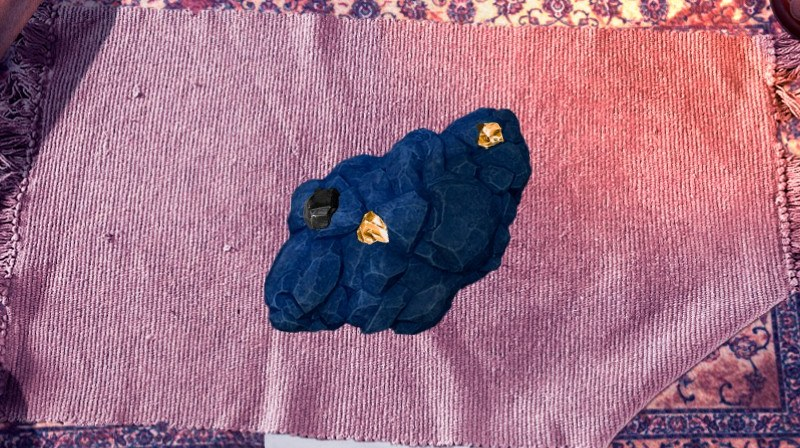
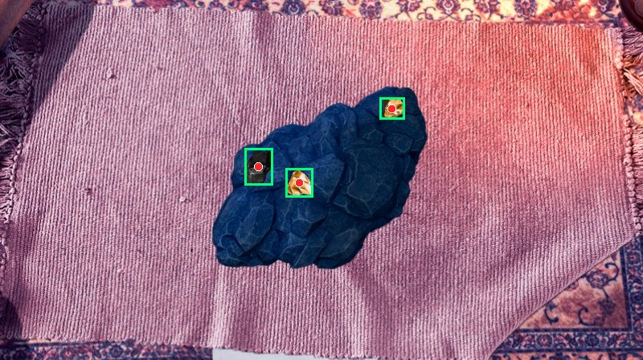
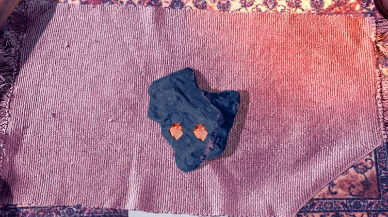
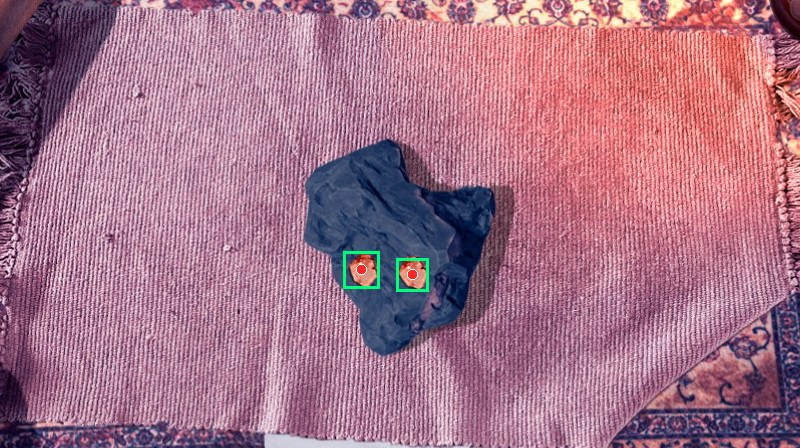

<div align="center">
  
#  Rocks Maj Farmer 

Бот для **Majestic RP** (GTA 5 RP) под Windows, который сам находит камушки на экране и кликает по ним.

Снимает игровую область, ищет камушки обученной нейросетью YOLO и по очереди тапает в центр каждого. Включается и выключается одной клавишей.

Создана в образовательных целях.
</div>

## Содержание
- ⚙️ Технологии
- 🔍 Как это работает
- 📋 Требования
- 📦 Установка и сборка
- 🎮 Использование
- 🔧 Настройка
- 🧠 Модель
- 💡 Примеры работы
- 📁 Структура проекта
- 📄 Лицензия

## ⚙️ Технологии
- <a href="https://wikipedia.org/wiki/C++"></a> C++17
- <a href="https://onnxruntime.ai"></a> ONNX Runtime: запуск модели
- <a href="https://github.com/ultralytics/ultralytics"></a> Ultralytics YOLO26n: обучение модели
- <a href="https://labelstud.io"></a> Label Studio: разметка датасета
- <a href="https://learn.microsoft.com/windows/win32/api/"></a> WinAPI: захват экрана (GDI), мышь и клавиатура
- <a href="https://cmake.org"></a> CMake: сборка

## 🔍 Как это работает
1. **Захват.** С экрана 1920×1080 снимается область 800×448 с левым верхним углом в точке (592, 264). Камушки появляются только там.
2. **Поиск.** Кадр вписывается в квадрат 640×640 и передаётся в модель. Модель возвращает рамки найденных камушков, рамки с уверенностью ниже 70% отбрасываются.
3. **Клики.** Рамки пересчитываются в координаты экрана, и программа по очереди кликает в центр каждой.
4. Цикл повторяется, пока бот включён. Если камушков нет, программа никуда не кликает.

## 📋 Требования
- Windows 10 (1703) или новее, разрешение экрана **1920×1080**.
- Visual Studio 2022 с компонентом «Разработка классических приложений на C++».
- CMake 3.20+.
- [ONNX Runtime](https://github.com/microsoft/onnxruntime/releases) для Windows x64.
- Игра в оконном режиме или в режиме «окно без рамки». В эксклюзивном полноэкранном режиме захват может возвращать чёрный кадр.

## 📦 Установка и сборка
Клонируем репозиторий:
```
git clone https://github.com/hm0on/rocks_maj_farmer.git
cd rocks_maj_farmer
```

Скачиваем со [страницы релизов ONNX Runtime](https://github.com/microsoft/onnxruntime/releases) архив `onnxruntime-win-x64-<версия>.zip` и распаковываем в `third_party/onnxruntime`, чтобы получилось так:
```
third_party/onnxruntime/include/onnxruntime_cxx_api.h
third_party/onnxruntime/lib/onnxruntime.lib
third_party/onnxruntime/lib/onnxruntime.dll
```

Собираем:
```
cmake -S . -B build -A x64
cmake --build build --config Release
```

Если ONNX Runtime лежит в другой папке, путь можно передать при настройке: `cmake -S . -B build -A x64 -DONNXRUNTIME_DIR=C:/path/to/onnxruntime`.

После сборки `onnxruntime.dll` автоматически копируется рядом с exe.

## 🎮 Использование
Запускаем **из корня репозитория**, потому что путь к модели относительный (`models/gem.onnx`):
```
build\Release\rocks_maj_farmer.exe
```

1. **Первый запуск.** Программа попросит нажать клавишу, которая будет включать и выключать бота. Лучше выбрать F-клавишу (F6, F8), буквы игра тоже получит как обычное нажатие. Клавиша сохранится в `toggle_key.txt`, и при следующих запусках программа её больше не спросит.
2. Заходим в игру и нажимаем бинд: раздаётся короткий пик, в консоли `ON`, бот начинает искать и кликать.
3. Нажимаем бинд ещё раз: снова пик, `OFF`, бот останавливается до следующего нажатия. Клавиша проверяется перед каждым кликом, так что остановка срабатывает сразу.
4. Выход: закрыть окно консоли.

Чтобы выбрать другую клавишу, удалите `toggle_key.txt` и перезапустите программу.

> Если игра запущена от имени администратора, программу тоже нужно запускать от администратора. Иначе Windows не пропустит клики в окно игры.

## 🔧 Настройка
Все параметры лежат константами в начале [`src/main.cpp`](src/main.cpp):

| Константа | По умолчанию | Что задаёт |
|---|---|---|
| `kGameArea` | `{592, 264, 800, 448}` | Область захвата: x, y, ширина, высота в пикселях экрана |
| `kModelPath` | `models/gem.onnx` | Путь к модели |
| `kToggleKeyPath` | `toggle_key.txt` | Файл с сохранённым биндом |
| `kMinScore` | `0.7` | Минимальная уверенность модели (0..1). Выше: меньше ложных кликов, но больше пропусков |
| `kDelayBetweenClicks` | `100 мс` | Пауза между кликами по соседним камушкам |
| `kDelayBetweenScans` | `300 мс` | Пауза после серии кликов, чтобы игра успела убрать нажатые камушки |
| `kKeyPollInterval` | `20 мс` | Как часто проверяется клавиатура, пока бот выключен |

Время нажатия кнопки мыши настраивается в [`src/input/mouse_controller.cpp`](src/input/mouse_controller.cpp): `kHoverDelay` (20 мс) и `kPressDuration` (30 мс).

Если у вас другое разрешение экрана, нужно поменять `kGameArea` под свою игровую область. Модель обучена на кадрах 800×448, поэтому лучше сохранить этот размер.

## 🧠 Модель
- Архитектура: **YOLO26n** (Ultralytics), один класс `gem`.
- Вход: `images` [1, 3, 640, 640]. Выход: `output0` [1, 300, 6], то есть до 300 рамок `x1, y1, x2, y2, уверенность, класс`. NMS встроен в модель.
- Датасет: около 160 скриншотов игровой области 800×448, размеченных в Label Studio.

Экспорт своей модели после обучения:
```
yolo export model=last.pt format=onnx
```
Получившийся файл кладём в `models/gem.onnx`.

## 💡 Примеры работы
Зелёные рамки — найденные камушки, красные точки — куда кликает программа.

> На картинках нарисованы рамки из разметки датасета, а не вывод программы.

### Пример №1:
Исходное изображение:



**Ищем камушки**

Куда кликнет программа:



---
### Пример №2:
Исходное изображение:



**Ищем камушки**

Куда кликнет программа:



## 📁 Структура проекта
```
src/
  main.cpp                  главный цикл, бинд вкл/выкл, настройки
  capture/screen_capture.*  захват области экрана через GDI
  detection/detector.*      подготовка кадра, запуск модели, пересчёт рамок в координаты экрана
  input/mouse_controller.*  клик мышью в точку экрана
models/gem.onnx             обученная модель
docs/                       картинки для README
```

## 📄 Лицензия
[AGPL-3.0](LICENSE). Модель обучена с помощью Ultralytics YOLO, который распространяется под AGPL-3.0, поэтому проект использует ту же лицензию.
